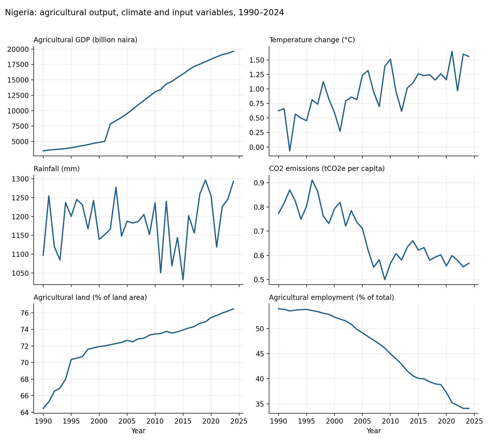
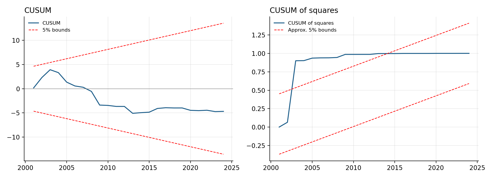

# Climate Change, CO2 Emissions and Agricultural Productivity in Nigeria (1990–2024)

An ARDL bounds-testing analysis of how temperature change, rainfall and CO2 emissions affect agricultural output in Nigeria, with agricultural land and labour as controls. This repository holds the data, methodology, open-source replication code and results behind my undergraduate research project (B.Sc. Economics, Federal University Oye-Ekiti, 2026).

**Author:** Sulyman Saleem Agboola
**Supervisor:** Prof. Amassoma Ditimi J.
**Method:** ARDL(1,2,0,0,0,0), bounds test, error correction model · **Sample:** 1990–2024 (33 observations after lags) · **Original software:** EViews · **Replication:** Python

## Key findings

- **A long-run relationship exists.** The bounds F-statistic is 4.30, above the 5% upper critical value of 4.01, so output, climate and input variables move together over time.
- **Adjustment is slow.** The error correction term is -0.073, meaning roughly 7% of any deviation from the long-run path is corrected each year.
- **Temperature change and agricultural land are the significant drivers** in the bounds-test regression. Temperature change has a negative coefficient (-0.222, p = 0.039); agricultural land has a positive one (0.035, p = 0.018). Both have the expected signs. Because both variables are in levels, the coefficients are semi-elasticities: a 1°C rise in temperature change is associated with roughly 20% lower agricultural GDP, and a 1 percentage-point rise in agricultural land share with roughly 3.6% higher agricultural GDP.
- **CO2 has the expected negative sign** (-0.442, p = 0.087), significant only at the 10% level. Rainfall and agricultural employment are not significant.
- **Implied long-run multipliers are imprecise.** Dividing by the error correction term gives larger long-run effects (e.g. temperature -3.02), but none is individually significant at 5% with only 33 observations. See the full table below.

## Data

Annual series for Nigeria, 1990–2024, from World Bank WDI, FAOSTAT, the CBN Statistical Bulletin, NiMet and ILOSTAT. No values were interpolated. Full definitions, units and sources: [`data/DATA_DICTIONARY.md`](data/DATA_DICTIONARY.md). Agricultural GDP (billion naira) rises sharply between 2001 and 2003; this looks like a rebasing break in the national accounts (see Limitations).



## Model

```
LnAGDP(t) = β0 + β1·TEMP(t) + β2·LnRAIN(t) + β3·CO2(t) + β4·LAND(t) + β5·LnLAB(t) + μ(t)
```

Grounded in the Cobb-Douglas production function with climate variables as environmental inputs. Variables are tested for stationarity with the Phillips-Perron test (mixed I(0)/I(1), none I(2)), lag orders are chosen by AIC, and cointegration is tested with the Pesaran-Shin-Smith bounds procedure. Details: [`methodology/METHODOLOGY.md`](methodology/METHODOLOGY.md).

## Results

**Bounds-test regression coefficients** (dependent variable: LnAGDP)

| Variable | Coefficient | p-value | Expected sign |
|---|---|---|---|
| TEMP | -0.2219 | 0.039 | negative |
| LRAIN | -0.1487 | 0.530 | positive |
| CO2 | -0.4423 | 0.087 | negative |
| LAND | 0.0353 | 0.018 | positive |
| LLAB | 0.1851 | 0.419 | positive |

**Long-run multipliers** (coefficient ÷ -ECT, delta-method standard errors)

| Variable | Multiplier | p-value |
|---|---|---|
| TEMP | -3.02 | 0.418 |
| LRAIN | -2.02 | 0.554 |
| CO2 | -6.02 | 0.283 |
| LAND | 0.48 | 0.349 |
| LLAB | 2.52 | 0.646 |

**Diagnostic tests** (all reproduced in Python and matching EViews)

| Test | Statistic | p-value | Verdict |
|---|---|---|---|
| Breusch-Godfrey (2 lags) | F = 0.719 | 0.498 | No serial correlation |
| Breusch-Pagan-Godfrey | F = 1.987 | 0.093 | No heteroskedasticity (F and LM versions); scaled explained SS rejects (p < 0.001) |
| Ramsey RESET (powers 2–3) | F = 2.495 | 0.106 | Passes on F; likelihood-ratio version rejects (p = 0.034) |
| Jarque-Bera (residuals) | 210.2 | < 0.001 | Residuals not normal |
| CUSUM | – | – | Stable |
| CUSUM of squares | – | – | Outside bounds, 2003–2014 |



## Limitations

- **A data break around 2002–2003.** The model's residual in 2002 (+0.26) is several times larger than any other year. It drives the non-normality (Jarque-Bera 210) and the CUSUM-of-squares breach. The most likely cause is a rebasing of Nigeria's national accounts, which creates a step in agricultural GDP that is not real growth. A structural-break dummy would be a natural robustness check.
- **Small sample.** With 33 observations the long-run multipliers are imprecise, and the bounds-test critical values are small-sample approximations.
- **Multicollinearity.** The lagged dependent variable (VIF 18.1), agricultural land (8.0) and agricultural employment (8.7) show high variance inflation factors, which inflates standard errors.
- **Mixed specification evidence.** RESET and heteroskedasticity results differ by test version, as shown in the table above.

## Repository structure

```
├── README.md
├── CITATION.cff
├── LICENSE
├── data/                 # dataset (CSV) and data dictionary
